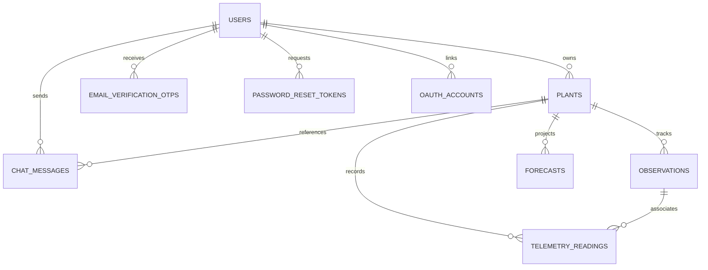

# PlantPulse AI — Database Architecture & Entity Relationships

## 1. Overview
PlantPulse AI uses a relational schema designed in SQLAlchemy and powered by SQLite 3 with enforced foreign keys (`PRAGMA foreign_keys = ON;`).

## 2. Entity-Relationship Diagram

## 3. Table Schemas & Column Definitions

### `users`
| Column | Type | Constraints | Description |
| :--- | :--- | :--- | :--- |
| `id` | VARCHAR(36) | PRIMARY KEY | UUIDv4 identifier |
| `email` | VARCHAR(255) | UNIQUE, NOT NULL, INDEX | Verified email address |
| `hashed_password` | VARCHAR(255) | NOT NULL | 60-char bcrypt hashed password |
| `full_name` | VARCHAR(150) | NULLABLE | Operator or farmer full name |
| `is_active` | BOOLEAN | NOT NULL, DEFAULT TRUE | Account operational status |
| `is_verified` | BOOLEAN | NOT NULL, DEFAULT FALSE | Email verification status |
| `preferred_language`| VARCHAR(10) | NOT NULL, DEFAULT 'en' | User language (`en`, `kn`, `hi`) |
| `voice_assistant_enabled` | BOOLEAN | NOT NULL, DEFAULT TRUE | Voice TTS/STT toggle |
| `created_at` | DATETIME | NOT NULL | Account creation timestamp |
| `updated_at` | DATETIME | NOT NULL | Last account update timestamp |

### `email_verification_otps`
| Column | Type | Constraints | Description |
| :--- | :--- | :--- | :--- |
| `id` | VARCHAR(36) | PRIMARY KEY | UUIDv4 identifier |
| `user_id` | VARCHAR(36) | FOREIGN KEY -> users(id) | Target user |
| `otp_hash` | VARCHAR(64) | NOT NULL, INDEX | SHA-256 hash of 6-digit OTP |
| `expires_at` | DATETIME | NOT NULL | Timestamp when code expires (10 min) |
| `is_used` | BOOLEAN | NOT NULL, DEFAULT FALSE | Single-use invalidation flag |
| `attempts` | INTEGER | NOT NULL, DEFAULT 0 | Failed verification attempt counter |
| `created_at` | DATETIME | NOT NULL | Dispatch timestamp |

### `plants`
| Column | Type | Constraints | Description |
| :--- | :--- | :--- | :--- |
| `id` | VARCHAR(36) | PRIMARY KEY | UUIDv4 plant identifier |
| `user_id` | VARCHAR(36) | FOREIGN KEY -> users(id), NULLABLE | Owner user ID (NULL for global demo) |
| `name` | VARCHAR(100) | NOT NULL | Plot or plant nickname |
| `crop_type` | VARCHAR(50) | NOT NULL, INDEX | Botanical family (Tomato, Chilli, etc.) |
| `crop_variety` | VARCHAR(50) | NOT NULL | Cultivar/hybrid name |
| `planting_date` | DATE | NOT NULL | Sowing/transplanting date |
| `location` | VARCHAR(100) | NULLABLE | Farm coordinates / polyhouse name |
| `description` | TEXT | NULLABLE | Soil, nutrient, and plot notes |
| `is_demo` | BOOLEAN | NOT NULL, DEFAULT FALSE | Demonstration dataset flag |
| `created_at` | DATETIME | NOT NULL | Creation timestamp |
| `updated_at` | DATETIME | NOT NULL | Last update timestamp |

### `observations`
| Column | Type | Constraints | Description |
| :--- | :--- | :--- | :--- |
| `id` | VARCHAR(36) | PRIMARY KEY | Observation UUID |
| `plant_id` | VARCHAR(36) | FOREIGN KEY -> plants(id) ON DELETE CASCADE | Target plant |
| `observation_date` | DATETIME | NOT NULL, INDEX | Field observation capture date |
| `image_path` | VARCHAR(500) | NULLABLE | Storage path for plant photograph |
| `manual_growth_stage`| VARCHAR(50) | NULLABLE | Agronomist-verified stage |
| `ai_growth_stage` | VARCHAR(50) | NULLABLE | Vision model predicted stage |
| `confidence_score`| FLOAT | NULLABLE | Softmax confidence score (0.00-1.00) |
| `model_version` | VARCHAR(50) | NULLABLE | Vision classifier model version |
| `stage_scores` | JSON | NULLABLE | Full stage probability distribution |
| `is_demo` | BOOLEAN | NOT NULL, DEFAULT FALSE | Sample data marker |

### `telemetry_readings`
| Column | Type | Constraints | Description |
| :--- | :--- | :--- | :--- |
| `id` | VARCHAR(36) | PRIMARY KEY | Sensor reading UUID |
| `plant_id` | VARCHAR(36) | FOREIGN KEY -> plants(id) ON DELETE CASCADE | Associated crop |
| `observation_id`| VARCHAR(36) | FOREIGN KEY -> observations(id), NULLABLE | Observation link |
| `parameter_name`| VARCHAR(50) | NOT NULL, INDEX | temperature, soil_moisture, etc. |
| `value` | FLOAT | NOT NULL | Sensor measurement numeric value |
| `unit` | VARCHAR(20) | NOT NULL | °C, %, hours, mm |
| `timestamp` | DATETIME | NOT NULL, INDEX | Measurement collection timestamp |
| `data_source` | VARCHAR(50) | NOT NULL | MANUAL_ENTRY, IOT_SENSOR, EXTERNAL_IMPORT |
| `sensor_id` | VARCHAR(100) | NULLABLE | Hardware hardware node MAC/ID |

### `forecasts`
| Column | Type | Constraints | Description |
| :--- | :--- | :--- | :--- |
| `id` | VARCHAR(36) | PRIMARY KEY | Forecast UUID |
| `plant_id` | VARCHAR(36) | FOREIGN KEY -> plants(id) ON DELETE CASCADE | Associated plant |
| `forecast_date` | DATETIME | NOT NULL | Calculation timestamp |
| `current_stage` | VARCHAR(50) | NOT NULL | Calibrated baseline stage |
| `method` | VARCHAR(100) | NOT NULL | Biophysical Thermal GDD Integration |
| `model_version` | VARCHAR(50) | NOT NULL | Forecaster version (v2.2.0) |
| `flowering_window` | JSON | NOT NULL | Start, end, status |
| `fruit_formation_window`| JSON | NOT NULL | Start, end, status |
| `maturity_window` | JSON | NOT NULL | Start, end, status |
| `harvest_window` | JSON | NOT NULL | Start, end, status |
| `environmental_factors` | JSON | NOT NULL | GDD, mean temp, soil moisture |
| `assumptions` | JSON | NOT NULL | Biophysical model assumptions |
| `limitations` | JSON | NOT NULL | Scientific bounds & disclaimers |
| `recommendations` | JSON | NOT NULL | Targeted agronomic actions |

### `chat_messages`
| Column | Type | Constraints | Description |
| :--- | :--- | :--- | :--- |
| `id` | VARCHAR(36) | PRIMARY KEY | Chat message UUID |
| `user_id` | VARCHAR(36) | FOREIGN KEY -> users(id) ON DELETE CASCADE | Message author |
| `role` | VARCHAR(20) | NOT NULL | 'user' or 'assistant' |
| `content` | TEXT | NOT NULL | Chat message text |
| `related_plant_id` | VARCHAR(36) | FOREIGN KEY -> plants(id), NULLABLE | Context plant |
| `created_at` | DATETIME | NOT NULL | Message timestamp |

---

## 4. Automatic Database Migration
On startup (`backend/app/main.py`), an automated migration verification routine checks table columns. If `plants.user_id` is absent, an `ALTER TABLE plants ADD COLUMN user_id VARCHAR(36)` command executes seamlessly without data loss.
