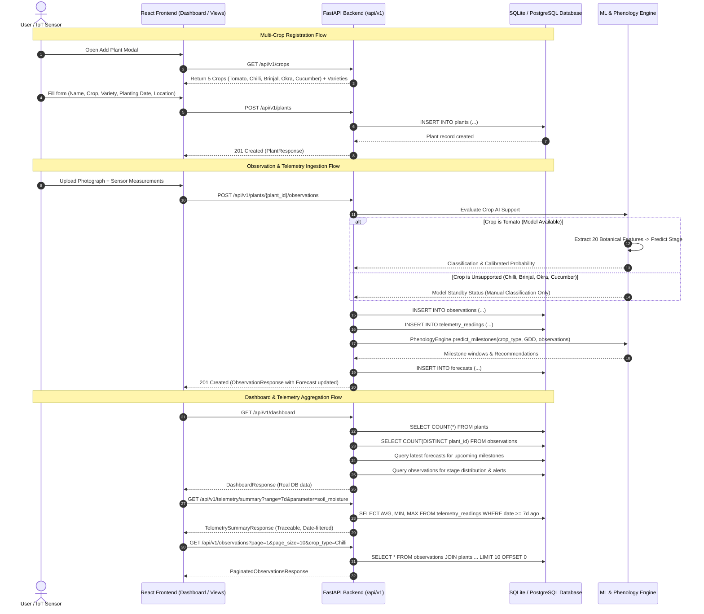

# PlantPulse AI — API Data Flow & Contract Specification

**Date:** 2026-11-06  
**Auditor:** Database Architect & Principal Software Engineer  
**Objective:** End-to-end data flow tracing from database entities to API contracts and frontend views.

---

## 1. End-to-End Architectural Data Flow



---

## 2. API Contract Enhancements

### A. Crop Catalog API
- `GET /api/v1/crops`:
  Returns array of available crops:
  ```json
  [
    {
      "id": "tomato",
      "name": "Tomato",
      "scientific_name": "Solanum lycopersicum",
      "varieties": ["Roma", "Cherry", "San Marzano", "Beefsteak"],
      "supported_stages": ["Seedling", "Vegetative", "Flowering", "Fruit Formation", "Maturity"],
      "has_ai_vision_model": true,
      "has_forecasting_model": true,
      "base_temperature_c": 10.0,
      "cutoff_temperature_c": 34.0,
      "is_active": true
    },
    {
      "id": "chilli",
      "name": "Chilli",
      "scientific_name": "Capsicum annuum",
      "varieties": ["Pusa Jwala", "Bird's Eye", "Bell Pepper", "Bhut Jolokia"],
      "supported_stages": ["Seedling", "Vegetative", "Flowering", "Fruit Formation", "Maturity"],
      "has_ai_vision_model": false,
      "has_forecasting_model": true,
      "base_temperature_c": 12.0,
      "cutoff_temperature_c": 35.0,
      "is_active": true
    },
    {
      "id": "brinjal",
      "name": "Brinjal (Eggplant)",
      "scientific_name": "Solanum melongena",
      "varieties": ["Pusa Purple Long", "Black Beauty", "Round Purple"],
      "supported_stages": ["Seedling", "Vegetative", "Flowering", "Fruit Formation", "Maturity"],
      "has_ai_vision_model": false,
      "has_forecasting_model": true,
      "base_temperature_c": 12.0,
      "cutoff_temperature_c": 35.0,
      "is_active": true
    },
    {
      "id": "okra",
      "name": "Okra (Lady's Finger)",
      "scientific_name": "Abelmoschus esculentus",
      "varieties": ["Pusa Sawani", "Arka Anamika", "Clemson Spineless"],
      "supported_stages": ["Seedling", "Vegetative", "Flowering", "Fruit Formation", "Maturity"],
      "has_ai_vision_model": false,
      "has_forecasting_model": true,
      "base_temperature_c": 15.0,
      "cutoff_temperature_c": 38.0,
      "is_active": true
    },
    {
      "id": "cucumber",
      "name": "Cucumber",
      "scientific_name": "Cucumis sativus",
      "varieties": ["Japanese Long", "Poona Kheera", "Poinsett"],
      "supported_stages": ["Seedling", "Vegetative", "Flowering", "Fruit Formation", "Maturity"],
      "has_ai_vision_model": false,
      "has_forecasting_model": true,
      "base_temperature_c": 10.0,
      "cutoff_temperature_c": 35.0,
      "is_active": true
    }
  ]
  ```

### B. Dedicated Telemetry Endpoints
- `GET /api/v1/telemetry/summary`:
  - **Query Params:** `range` (e.g. `24h`, `7d`, `30d`, `90d`, `all`), `plant_id`, `crop_type`
  - **Response:**
    - `period`: string label
    - `readings_count`: total measurements in period
    - `mean_temperature`: float or null
    - `mean_soil_moisture`: float or null
    - `relative_humidity`: float or null
    - `daily_sunlight_hours`: float or null
    - `total_precipitation`: float or null
    - `source_breakdown`: object showing counts for `IOT_SENSOR`, `MANUAL_ENTRY`, `EXTERNAL_IMPORT`
- `GET /api/v1/telemetry/readings`:
  - **Query Params:** `parameter` (`temperature`, `soil_moisture`, etc.), `range`, `plant_id`, `crop_type`
  - **Response:** Array of historical timestamped readings with units and data sources.
- `POST /api/v1/telemetry/readings`:
  - Validates and ingests standalone IoT or manual readings.

### C. Paginated Observations Endpoint
- `GET /api/v1/observations`:
  - **Query Params:** `page` (default 1), `page_size` (default 10), `crop_type`, `plant_id`, `growth_stage`, `search`
  - **Response:**
    ```json
    {
      "items": [
        {
          "id": "...",
          "plant_id": "...",
          "plant_name": "...",
          "crop_type": "...",
          "observation_date": "...",
          "image_path": "...",
          "temperature": 24.5,
          "humidity": 60.0,
          "soil_moisture": 55.0,
          "sunlight_hours": 8.0,
          "rainfall": 0.0,
          "effective_stage": "Flowering",
          "ai_growth_stage": "Flowering",
          "manual_growth_stage": null,
          "confidence_score": 0.94,
          "model_version": "1.0.0",
          "is_demo": false
        }
      ],
      "total": 24,
      "page": 1,
      "page_size": 10,
      "pages": 3
    }
    ```
